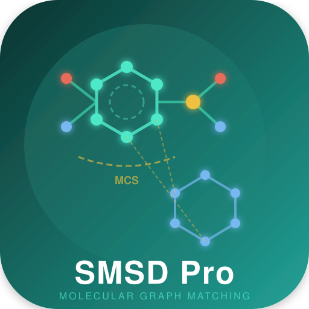

<p align="center">
  <a href="https://github.com/asad/SMSD" aria-label="SMSD Pro">
    
  </a>
</p>

<h1 align="center">SMSD Pro™</h1>
<p align="center"><strong>Substructure and MCS search for chemical graphs</strong></p>

<p align="center">
  <a href="https://central.sonatype.com/artifact/com.bioinceptionlabs/smsd"></a>
  <a href="https://pypi.org/project/smsd/"></a>
  <a href="LICENSE"></a>
  <a href="https://github.com/asad/SMSD/releases"></a>
</p>

SMSD Pro provides substructure search and maximum common substructure (MCS)
search for C++, Java and Python, with the same search model in each language.
Every result states whether the search completed, proved its optimum or stopped
at its timeout, and maps atoms by their zero-based indices in the input molecules.

- **C++**: a header-only C++17 library.
- **Java**: a library and command-line tool for CDK 2.13 molecules, running on Java 8 or later.
- **Python**: a binding to the native library that accepts RDKit molecules when
  RDKit is installed and converts Open Babel molecules.

## Installation

This page describes version 8.0.0. It is distributed as `smsd` on
[PyPI](https://pypi.org/project/smsd/), as `com.bioinceptionlabs:smsd`
(library) and `com.bioinceptionlabs:smsd-cli` (command-line tool) on
[Maven Central](https://central.sonatype.com/artifact/com.bioinceptionlabs/smsd)
and as release files on the
[GitHub releases page](https://github.com/asad/SMSD/releases), and it can be
built from this repository. The [release notes](docs/RELEASE_NOTES.md) list the
release files and their platform requirements.

The C++ and Python builds need a C++17 compiler, and the Python package supports
Python 3.9 or later. The Java build uses Maven and a JDK, with Java 25 LTS
preferred. The [installation guide](docs/HOWTO-INSTALL.md) covers platform
requirements, Python wheels,
[Java CLI installers](docs/HOWTO-INSTALL.md#java-cli-installers), Docker and
test commands.

## Quick start

Each example finds benzene in phenol, then computes their MCS. Run the commands
from the repository root.

### C++

Save this as `example.cpp`:

```cpp
#include <smsd/smsd.hpp>
#include <iostream>

int main() {
    const auto query = smsd::parseSMILES("c1ccccc1");      // benzene
    const auto target = smsd::parseSMILES("c1ccc(O)cc1");  // phenol
    const bool embedded = !smsd::Substructure::find(query).match(target).matches.empty();
    const auto result = smsd::MCS::find(query).match(target);
    if (!embedded || !result.optimal || result.matches.empty()
            || result.matches.front().atomMapping.size() != 6) {
        return 1;
    }
    std::cout << "MCS atoms: " << result.matches.front().atomMapping.size() << '\n';
    return 0;
}
```

```bash
c++ -std=c++17 -O2 -pthread -I cpp/include example.cpp -o example
./example
```

See the [C++ module](cpp/README.md) and the [C++ guide](docs/CPP.md).

### Java

Build and install the library and the command-line tool into the local Maven
repository:

```bash
mvn -f java/pom.xml install
```

Maven projects can then use the library, which brings only the CDK modules it
needs:

```xml
<dependency>
  <groupId>com.bioinceptionlabs</groupId>
  <artifactId>smsd</artifactId>
  <version>8.0.0</version>
</dependency>
```

In Gradle, write `implementation("com.bioinceptionlabs:smsd:8.0.0")`. The
example below also parses SMILES, which needs `org.openscience.cdk:cdk-smiles:2.13`;
the [Java module](java/README.md#installation) lists the optional additions and
the `smsd-cli` artefact. Save this as `QuickStart.java`:

```java
import com.bioinception.smsd.core.MCS;
import com.bioinception.smsd.core.SearchResult;
import com.bioinception.smsd.core.Substructure;
import org.openscience.cdk.interfaces.IAtomContainer;
import org.openscience.cdk.silent.SilentChemObjectBuilder;
import org.openscience.cdk.smiles.SmilesParser;

public class QuickStart {
    public static void main(String[] args) throws Exception {
        SmilesParser parser = new SmilesParser(SilentChemObjectBuilder.getInstance());
        IAtomContainer query = parser.parseSmiles("c1ccccc1");      // benzene
        IAtomContainer target = parser.parseSmiles("c1ccc(O)cc1");  // phenol
        boolean embedded = Substructure.find(query).match(target).found();
        SearchResult result = MCS.find(query).withTimeout(1000).match(target);
        if (!embedded || !result.optimal() || !result.found()
                || result.matches().get(0).atomCount() != 6) {
            throw new IllegalStateException("Expected a proved six-atom match");
        }
        System.out.println("MCS atoms: " + result.matches().get(0).atomCount());
    }
}
```

Compile with Java 25 and run on Java 8 or later, here against the self-contained
JAR of the build, which includes CDK and `cdk-smiles`:

```bash
javac --release 8 -cp java/cli/target/smsd-cli-8.0.0-jar-with-dependencies.jar QuickStart.java
java -cp "java/cli/target/smsd-cli-8.0.0-jar-with-dependencies.jar:." QuickStart
```

With a Java 8 compiler, omit `--release 8`. On Windows, separate the classpath
entries with `;` instead of `:`. The [Java module](java/README.md) shows atom
mappings for CDK containers, and the [Java guide](docs/JAVA.md) covers the full API.

### Python

Build and install the package from the checkout:

```bash
python -m pip install -e .
```

```python
import smsd

query = "c1ccccc1"       # benzene
target = "c1ccc(O)cc1"   # phenol
assert smsd.Substructure.find(query).match(target).found
result = smsd.MCS.find(query).match(target)
assert result.optimal and result.best.atom_count == 6
print("MCS atoms:", result.best.atom_count)
```

See the [Python package](python/README.md), the [Python guide](docs/PYTHON.md)
and the [Python examples](docs/EXAMPLES.md).

### Command line

The Java build also produces the command-line tool, as a self-contained JAR:

```bash
java -jar java/cli/target/smsd-cli-8.0.0-jar-with-dependencies.jar \
  --Q SMI --q "c1ccccc1" --T SMI --t "c1ccc(O)cc1" --json -
```

This runs a substructure search; add `--mode mcs` for MCS search, and use
`--help` to list every option. The tool also reads MOL, MOL2, CML and PDB files,
and SDF files as batch targets.

## Features

- **Substructure search** with molecule or SMARTS queries, as non-induced
  (default) or induced embeddings.
- **MCS search** for the maximum common induced subgraph (MCIS) or the maximum
  common edge subgraph (MCES), connected or as disconnected fragments, with
  optional atom weights.
- **Chemistry options** for bond order, aromaticity, formal charge, isotopes,
  ring membership, stereo and tautomers.
- **Prepared queries** that can be searched against many targets, in turn or on
  several threads.
- **Fingerprints** and similarity metrics for screening. The native library
  screens batches with OpenMP where available and, in source builds, can use optional CUDA and
  Apple Metal backends (`SMSD_BUILD_CUDA`, `SMSD_BUILD_METAL`).
- **Further tools**, including R-group decomposition, MOL and SDF input,
  SVG depiction (C++ and Python) and molecular standardisation (Java).

### Search calls

`MCS` and `Substructure` prepare a reusable query and offer the same calls:

| Call | C++ and Java | Python |
| --- | --- | --- |
| Best match for one target | `match(target)` | `match(target)` |
| All optimal MCS mappings, or all substructure embeddings, up to a limit (default 1,000) | `matchAll(target, limit)` | `match_all(target, limit)` |
| Independent searches over a collection of targets | `matchMany(targets)` | `match_many(targets)` |

`MCS` defaults to a connected MCIS. Without atom weights, MCIS preserves both
edges and non-edges between the mapped atoms and maximises atoms, then bonds.
MCES selects compatible common edges and maximises bonds, then their incident
atoms. A search that reaches its timeout can still return a valid mapping;
check the optimality and completion flags before treating it as a proved optimum.

## Performance

No performance figures are published for 8.0.0 on this page. The
[benchmark guide](benchmarks/README.md) defines how they are produced: shared
prepared-query workloads for C++, Java and Python; independent validation of
every returned mapping before any timing is analysed; and separate reporting of
completed, stopped and timed-out searches. Release checks for 8.0.0 are recorded
in the [validation record](docs/VALIDATION_8.0.0.md) as they complete.

## Documentation

| Guide | Contents |
| --- | --- |
| [Installation](docs/HOWTO-INSTALL.md) | Platform requirements, installers and source builds |
| [C++ guide](docs/CPP.md) | Header-only library, chemistry options and file input |
| [Java guide](docs/JAVA.md) | CDK molecules, search, fingerprints, R-groups and the command-line tool |
| [Python guide](docs/PYTHON.md) | Search, results, chemistry options and RDKit integration |
| [Python examples](docs/EXAMPLES.md) | Fingerprints, depiction, layout, stereo, files and R-groups |
| [Search algorithms](docs/ALGORITHMS.md) | Search stages, result semantics and differences between the languages |
| [Benchmarks](benchmarks/README.md) | Workloads, mapping validation and measurement protocol |
| [Validation record](docs/VALIDATION_8.0.0.md) | Release checks for 8.0.0 |
| [Release notes](docs/RELEASE_NOTES.md) | Highlights, downloads, platform requirements and upgrade notes for 8.0.0 |
| [Changelog](CHANGELOG.md) | What 8.0.0 provides: API, search behaviour, chemistry, fingerprints and packaging |

The [Java guide](docs/JAVA.md#api-reference) explains how to
generate the Javadoc reference from this checkout.

To run every Python, Java and C++ code block in these guides, build the
current source, then run:

```bash
python scripts/check_examples.py \
  --jar java/cli/target/smsd-cli-8.0.0-jar-with-dependencies.jar \
  --report build/example-check.json
```

Use `--languages python` to check one language. Examples that need RDKit are
skipped when it is not installed, and the report lists every failure.

## Licence

SMSD Pro is released under the [Apache License 2.0](LICENSE). The same terms
apply to academic and commercial use, with no fee or registration. Redistributions
must include the [LICENSE](LICENSE) and [NOTICE](NOTICE) files and retain the
copyright notices; the NOTICE file also sets out the trademark terms. Bundled
dependencies carry their own licence notices. The Java CLI JAR with
dependencies, the portable CLI archive, the CLI installers and the Docker image
bundle CDK under the [LGPL-2.1](licenses/cdk/README.md); for the runtimes that Python
wheels can bundle, see the [LLVM OpenMP](licenses/libomp/LICENSE.TXT),
[GCC OpenMP](licenses/libgomp/README.md) and
[Microsoft C++ and OpenMP](licenses/msvc/README.md) notices.

## Citation

If you use SMSD Pro in research, please cite:

> Rahman SA. *SMSD Pro: Coverage-Driven, Tautomer-Aware Maximum Common Substructure Search.*
> ChemRxiv, 2026.
> DOI: [10.26434/chemrxiv.15001534/v1](https://doi.org/10.26434/chemrxiv.15001534/v1)

> Rahman SA, Bashton M, Holliday GL, Schrader R, Thornton JM.
> *Small Molecule Subgraph Detector (SMSD) toolkit.*
> Journal of Cheminformatics, 1:12, 2009.
> DOI: [10.1186/1758-2946-1-12](https://doi.org/10.1186/1758-2946-1-12)

Citation metadata is available in [CITATION.cff](CITATION.cff).

Copyright (c) 2018-2026 BioInception PVT LTD.
Algorithm Copyright (c) 2009-2026 Syed Asad Rahman.
