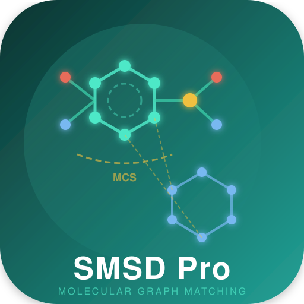

<p align="center">
  <a href="https://github.com/asad/SMSD" aria-label="SMSD Pro">
    
  </a>
</p>

<h1 align="center">SMSD Pro™</h1>
<p align="center"><strong>Substructure and MCS search for chemical graphs</strong></p>

<p align="center">
  <a href="https://central.sonatype.com/artifact/com.bioinceptionlabs/smsd"></a>
  <a href="https://pypi.org/project/smsd/"></a>
  <a href="https://pepy.tech/projects/smsd"></a>
  <a href="https://anaconda.org/bioinception/smsd"></a>
  <a href="https://asad.github.io/SMSD/"></a>
  <a href="https://doi.org/10.5281/zenodo.23639199"></a>
  <a href="LICENSE"></a>
  <a href="https://github.com/asad/SMSD/releases"></a>
</p>

SMSD Pro provides substructure search and maximum common substructure (MCS)
search for C++, Java and Python, with the same search model in each language.
Every result reports completion, proved optimality and the reason it stopped,
and maps atoms by their zero-based indices in the input molecules.

- **C++**: a header-only C++17 library.
- **Java**: a library and command-line tool for CDK 2.13 molecules, running on
  Java 8 or later.
- **Python**: a binding to the native library that accepts RDKit molecules when
  RDKit is installed and converts Open Babel molecules.

## What's new in 8.2.0

- **GPU screening on Apple silicon.** The optional `smsd-metal` package lets
  prepared fingerprint screens run on the Mac's GPU, with the same hits and
  scores as the CPU.
- **GPU screening on Windows.** A
  [step-by-step guide](docs/guide/GPU_ON_WINDOWS.md) covers NVIDIA GPUs
  through WSL2.
- **Publication-ready figures.** Regular rings, crisp labels and one soft halo
  over the shared core: gold for MCS, mint for substructure hits, ready for
  papers, theses and slides.
- **Errors AI assistants can act on.** When a model calls a tool with a
  wrong argument, SMSD names it and lists what it accepts, so the model
  can correct itself.
- **Time limits that hold.** Short time limits hold on very large molecules,
  so high-throughput pipelines keep to schedule.
- **Seven ready-to-run notebooks** that run in Colab and set themselves up;
  [try the MCS notebook](https://colab.research.google.com/github/asad/SMSD/blob/master/python/examples/mcs_search.ipynb).

Completed searches return the same results as in 8.1.0, and every 8.x API
remains supported. The [release notes](docs/RELEASE_NOTES.md) cover the
upgrade.

The Java library and command-line tool are stable and continue to
receive bug fixes, while new features arrive in C++ and
Python first. Maven Central carries 8.2.0. A [source build](#java) is also available.

Beyond search, the 8.x line brings [Python data and ML adapters](docs/PYTHON_ADAPTERS.md),
[local molecular tools and MCP](docs/MCP_SERVER.md),
[packed fingerprint corpora and clustering](docs/PACKED_CORPORA.md) and
[SMARTS export](docs/SMARTS_EXPORT.md); optional dependencies load only when
used. [Conda recipes](packaging/conda/README.md) build `smsd` and `smsd-cuda`
for conda, mamba and Pixi, and an [MCP container recipe](packaging/mcp/README.md)
and [Hugging Face demonstration](examples/huggingface/README.md) are included.

## Installation

| Language | Package | Requirements |
| --- | --- | --- |
| Python | `smsd` on [PyPI](https://pypi.org/project/smsd/) | CPython 3.12–3.15; RDKit optional |
| Python, NVIDIA GPU (optional) | `smsd-cuda` on [PyPI](https://pypi.org/project/smsd-cuda/) | Linux x86_64 with an NVIDIA GPU and a driver for CUDA 12; the same version as `smsd` |
| Python, Apple GPU (optional) | `smsd-metal` on [PyPI](https://pypi.org/project/smsd-metal/) | macOS 14 or later on Apple silicon; the same version as `smsd` |
| Java | `com.bioinceptionlabs:smsd` (library) and `com.bioinceptionlabs:smsd-cli` (command-line tool) on [Maven Central](https://central.sonatype.com/artifact/com.bioinceptionlabs/smsd), at 8.2.0 | Java 8 or later; CDK 2.13 |
| C++ | Header-only library in `cpp/include` | A C++17 compiler |

Release files are on the [GitHub releases page](https://github.com/asad/SMSD/releases).
The [supported-platforms table](docs/HOWTO-INSTALL.md#supported-platforms)
covers the CPU wheels, the optional CUDA and Metal packages and the Java
JARs. The
[installation guide](docs/HOWTO-INSTALL.md) explains downloads and source builds.

## Quick start

Each example finds benzene in phenol, then computes the MCS of
N-methylacetamide and propanamide. Neither contains the other; they share the
four atoms of C–C(=O)–N. Run the commands from the repository root.

### C++

Save this as `example.cpp`:

```cpp
#include <smsd/smsd.hpp>
#include <iostream>

int main() {
    const auto benzene = smsd::parseSMILES("c1ccccc1");
    const auto phenol = smsd::parseSMILES("c1ccc(O)cc1");
    const bool embedded = !smsd::Substructure::find(benzene).match(phenol).matches.empty();
    const auto query = smsd::parseSMILES("CC(=O)NC");   // N-methylacetamide
    const auto target = smsd::parseSMILES("CCC(=O)N");  // propanamide
    const auto result = smsd::MCS::find(query).match(target);
    if (!embedded || !result.optimal || result.matches.empty()
            || result.matches.front().atomMapping.size() != 4) {
        return 1;
    }
    std::cout << "MCS atoms: " << result.matches.front().atomMapping.size() << '\n';
    return 0;
}
```

```bash
c++ -std=c++17 -O2 -pthread -I cpp/include example.cpp -o example
./example
```

See the [C++ module](cpp/README.md) and the [C++ guide](docs/CPP.md).

### Java

Build and install the library and the command-line tool into the local Maven
repository:

```bash
mvn -f java/pom.xml install
```

Maven projects can use the 8.2.0 library from Maven Central. It brings only
the CDK modules it needs:

```xml
<dependency>
  <groupId>com.bioinceptionlabs</groupId>
  <artifactId>smsd</artifactId>
  <version>8.2.0</version>
</dependency>
```

In Gradle, write `implementation("com.bioinceptionlabs:smsd:8.2.0")`. The
example below also parses SMILES, which needs `org.openscience.cdk:cdk-smiles:2.13`;
the [Java module](java/README.md#installation) lists the optional additions and
the `smsd-cli` artefact. Save this as `QuickStart.java`:

```java
import com.bioinception.smsd.core.MCS;
import com.bioinception.smsd.core.SearchResult;
import com.bioinception.smsd.core.Substructure;
import org.openscience.cdk.interfaces.IAtomContainer;
import org.openscience.cdk.silent.SilentChemObjectBuilder;
import org.openscience.cdk.smiles.SmilesParser;

public class QuickStart {
    public static void main(String[] args) throws Exception {
        SmilesParser parser = new SmilesParser(SilentChemObjectBuilder.getInstance());
        IAtomContainer benzene = parser.parseSmiles("c1ccccc1");
        IAtomContainer phenol = parser.parseSmiles("c1ccc(O)cc1");
        boolean embedded = Substructure.find(benzene).match(phenol).found();
        IAtomContainer query = parser.parseSmiles("CC(=O)NC");   // N-methylacetamide
        IAtomContainer target = parser.parseSmiles("CCC(=O)N");  // propanamide
        SearchResult result = MCS.find(query).withTimeout(1000).match(target);
        if (!embedded || !result.optimal() || !result.found()
                || result.matches().get(0).atomCount() != 4) {
            throw new IllegalStateException("Expected a proved four-atom MCS");
        }
        System.out.println("MCS atoms: " + result.matches().get(0).atomCount());
    }
}
```

Compile with Java 25 and run on Java 8 or later, here against the self-contained
JAR of the build, which includes CDK and `cdk-smiles`:

```bash
javac --release 8 -cp java/cli/target/smsd-cli-8.2.0-jar-with-dependencies.jar QuickStart.java
java -cp "java/cli/target/smsd-cli-8.2.0-jar-with-dependencies.jar:." QuickStart
```

With a Java 8 compiler, omit `--release 8`. On Windows, separate the classpath
entries with `;` instead of `:`. The [Java module](java/README.md) shows atom
mappings for CDK containers, and the [Java guide](docs/JAVA.md) covers the full API.

### Python

Build and install the package from the checkout:

```bash
python -m pip install -e .
```

```python
import smsd

assert smsd.Substructure.find("c1ccccc1").match("c1ccc(O)cc1").found  # benzene in phenol
query = "CC(=O)NC"    # N-methylacetamide
target = "CCC(=O)N"   # propanamide
result = smsd.MCS.find(query).match(target)
assert result.optimal and result.best.atom_count == 4
print("MCS atoms:", result.best.atom_count)
```

See the [Python package](python/README.md), the [Python guide](docs/PYTHON.md)
and the [Python examples](docs/EXAMPLES.md).

### Screening

Rank a library by ECFP4 similarity, then search it by substructure as a
prepared corpus; the search can use every core:

```python
import smsd

library = ["CC(=O)Oc1ccccc1", "OC(=O)c1ccccc1O", "CC(=O)Nc1ccc(O)cc1", "c1ccccc1"]
ranked = smsd.batch_similarity("CC(=O)Oc1ccccc1C(=O)O", library)  # aspirin
corpus = smsd.TargetCorpus.from_smiles(library)
corpus.prewarm()
acids = smsd.Substructure.smarts("C(=O)[OX2H1]").match_many(corpus, num_threads=0)
print([library[i] for i, _ in ranked][:2], sum(r.found for r in acids))
```

The [Python examples](docs/EXAMPLES.md#screening) screen a library of 2,744
molecules and filter by MCS similarity before computing the MCS.

### GPU screening (optional)

On Linux x86_64 with an NVIDIA GPU, install `smsd-cuda` next to `smsd` of the
same version:

```bash
python -m pip install "smsd==8.2.0" "smsd-cuda==8.2.0"
```

ECFP4 screens of a prepared `TargetCorpus` use the GPU automatically on a Tesla
T4 when the corpus has at least 100,000 targets, with no change to your code,
and the prepared fingerprints stay on the device between screens. Exact graph
matching always uses the CPU. Smaller corpora and other devices screen on the
CPU unless `SMSD_CUDA_MIN_TARGETS` is set to a positive integer, which replaces
the T4 default (see [CUDA screening](docs/PYTHON.md#optional-cuda-screening)).
On any NVIDIA GPU with compute capability 7.5 or later, request the device
explicitly with the packed-corpus backend `"cuda"` or with `match_corpus(...,
gpu_prefilter=True)`; the [GPU screening
example](python/examples/gpu_screening.py) shows both. The native screen
preserves CPU scores and hit order, with CPU fallback on a GPU error. See [CUDA
screening](docs/PYTHON.md#optional-cuda-screening) for that contract. The
explicit packed-corpus backends have a separate [error and fallback
contract](docs/PACKED_CORPORA.md#cpu-and-cuda-backends).

The [`smsd-cuda` package](packaging/smsd-cuda/README.md) also provides kernel
preloading, bounded retained workspaces, opt-in CUDA Graph replay and on-device
top-k filtering.

On an Apple silicon Mac, install [`smsd-metal`](packaging/smsd-metal/README.md)
instead:

```bash
python -m pip install "smsd==8.2.0" "smsd-metal==8.2.0"
```

The same prepared ECFP4 screens then use the Apple GPU automatically on an
Apple M5 for corpora of at least 100,000 targets. `SMSD_METAL_MIN_TARGETS`
extends this to other Apple GPUs and smaller corpora, and
`match_corpus(..., gpu_prefilter=True)` requests the Apple GPU for a
pre-screen. Packed fingerprint indexes do not use Metal. [CPU and GPU
screening](docs/guide/CPU_GPU.md) describes both packages side by side.

The [8.2.0 release](https://github.com/asad/SMSD/releases/tag/v8.2.0) has a GPU
Docker image, `smsd-8.2.0-cuda-linux-amd64.tar.xz`, with Python, `smsd`,
`smsd-cuda` and the CUDA runtime. The image needs the NVIDIA Container Toolkit:

```bash
docker load -i smsd-8.2.0-cuda-linux-amd64.tar.xz
docker run --rm --gpus all smsd:8.2.0-cuda12.8 -c "import smsd; print(smsd.gpu_device_info())"
```

Native Windows CUDA is not provided. On Windows, use the Linux CUDA package or
this image under WSL2, as described in
[GPU screening on Windows](docs/guide/GPU_ON_WINDOWS.md).

The [installation guide](docs/HOWTO-INSTALL.md#docker) covers the CPU images
for amd64 and arm64.

### Command line

The Java build also produces the command-line tool, as a self-contained JAR:

```bash
java -jar java/cli/target/smsd-cli-8.2.0-jar-with-dependencies.jar \
  --Q SMI --q "c1ccccc1" --T SMI --t "c1ccc(O)cc1" --json -
```

This runs a substructure search; add `--mode mcs` for MCS search, and use
`--help` to list every option. The tool also reads MOL, MOL2, CML and PDB files,
and SDF files as batch targets.

## Features

- **Substructure search** with molecule or SMARTS queries, as non-induced
  (default) or induced embeddings.
- **MCS search** for the maximum common induced subgraph (MCIS) or the maximum
  common edge subgraph (MCES), connected or as disconnected fragments, with
  optional atom weights.
- **Chemistry options** for bond order, aromaticity, formal charge, isotopes,
  ring membership, stereo and tautomers.
- **Prepared queries** that can be searched against many targets, in turn or on
  several threads.
- **Fingerprints for screening:** circular (ECFP and FCFP), path,
  topological-torsion and structural-key fingerprints, including the 166 MACCS
  keys, configured once with `FingerprintOptions` (rings, ring sizes, R/S and
  E/Z, fragments, Murcko framework) and giving the same bits in C++, Java and
  Python of the same version. Batch searches can use every processor core.
  Optional GPU screening is provided separately by `smsd-cuda` for NVIDIA GPUs
  and `smsd-metal` for Apple silicon Macs; matching runs on the CPU. See
  [CPU and GPU screening](docs/guide/CPU_GPU.md) for its scope. Native C++
  source builds on macOS also include [optional Metal
  support](docs/CPP.md#optional-metal-fingerprint-screening), used only by
  programs that link it.
- **Utilities**, including R-group decomposition, MOL and SDF input,
  SVG depiction (C++ and Python) and molecular standardisation (Java).

### Search calls

`MCS` and `Substructure` prepare a reusable query and offer the same calls:

| Call | C++ and Java | Python |
| --- | --- | --- |
| Best match for one target | `match(target)` | `match(target)` |
| All optimal MCS mappings, or all substructure embeddings, up to a limit (default 1,000) | `matchAll(target, limit)` | `match_all(target, limit)` |
| Independent searches over a collection of targets | `matchMany(targets)` | `match_many(targets)` |

`MCS` defaults to a connected MCIS. Without atom weights, MCIS maximises mapped
atoms, then bonds; MCES maximises common bonds, then their atoms. A search that
reaches its timeout can still return a valid mapping, so check the completion
and optimality flags before treating it as a proved optimum.

## Documentation

The documentation site, [asad.github.io/SMSD](https://asad.github.io/SMSD/),
brings the user guide, notebooks and reference together. The same pages are
in this repository:

| Guide | Contents |
| --- | --- |
| [User guide](docs/guide/README.md) | Task-based chapters: getting started, substructure and SMARTS, MCS, fingerprints, screening, the packed index, CPU and GPU, command line, C++ and Java |
| [Installation](docs/HOWTO-INSTALL.md) | Platform requirements, downloads and source builds |
| [C++ guide](docs/CPP.md) | Header-only library, chemistry options and file input |
| [Java guide](docs/JAVA.md) | CDK molecules, search, fingerprints, R-groups and the command-line tool |
| [Python guide](docs/PYTHON.md) | Search, results, chemistry options and RDKit integration |
| [Python examples](docs/EXAMPLES.md) and [notebooks](python/examples/README.md) | Fingerprints, screening, depiction, layout, stereo, files and R-groups |
| [Python adapters](docs/PYTHON_ADAPTERS.md) | NumPy, SciPy, pandas, Polars, Arrow, PyTorch, scikit-learn and PyTorch Geometric |
| [Molecular tools and MCP](docs/MCP_SERVER.md) | Bounded local tools, proof/status fields, function definitions and framework adapters |
| [Connecting AI assistants](docs/AI_ASSISTANTS.md) | Local MCP set-up for assistant clients and tool definitions for your own Python loop |
| [API reference](docs/API_REFERENCE.md) | Interfaces, options, proof and stopping status, I/O, fingerprints, adapters and GPU scope |
| [Packed corpora](docs/PACKED_CORPORA.md) | Memory-mapped rows, CPU/CUDA scans, exact top-k, Butina and MaxMin |
| [Conda recipes](packaging/conda/README.md) | CPU and CUDA recipes, with conda, mamba and Pixi routes |
| [SMARTS export](docs/SMARTS_EXPORT.md) | Selected common bonds, match-option constraints and library search |
| [Search algorithms](docs/ALGORITHMS.md) | Search guarantees, result semantics and differences between the languages |
| [Benchmarks](benchmarks/README.md) | How to run the benchmarks and report results |
| [Release notes](docs/RELEASE_NOTES.md) | Highlights, downloads and upgrade notes for each release |
| [Changelog](CHANGELOG.md) | Changes in each release |

The [Java guide](docs/JAVA.md#api-reference) explains how to generate the
Javadoc reference.

## Licence

SMSD Pro is released under the [Apache License 2.0](LICENSE). The same terms
apply to academic and commercial use, with no fee or registration. Redistributions
must include the [LICENSE](LICENSE) and [NOTICE](NOTICE) files and retain the
copyright notices; the NOTICE file also sets out the trademark terms. Bundled
dependencies carry their own licence notices. The Java CLI JAR with
dependencies and the CPU Docker images bundle CDK under the [LGPL-2.1](licenses/cdk/README.md), Beam under the
[BSD 2-Clause License](licenses/beam/LICENSE) and vecmath under the
[GPL-2.0 with the Classpath exception](licenses/vecmath/README.md); for the
runtimes that Python wheels can bundle, see the
[LLVM OpenMP](licenses/libomp/LICENSE.TXT),
[GCC OpenMP](licenses/libgomp/README.md) and
[Microsoft C++ and OpenMP](licenses/msvc/README.md) notices.

## Citation

If you use SMSD Pro in research, please cite:

> Rahman SA. *SMSD Pro: Coverage-Driven, Tautomer-Aware Maximum Common Substructure Search.*
> ChemRxiv, 2026.
> DOI: [10.26434/chemrxiv.15001534/v1](https://doi.org/10.26434/chemrxiv.15001534/v1)

> Rahman SA, Bashton M, Holliday GL, Schrader R, Thornton JM.
> *Small Molecule Subgraph Detector (SMSD) toolkit.*
> Journal of Cheminformatics, 1:12, 2009.
> DOI: [10.1186/1758-2946-1-12](https://doi.org/10.1186/1758-2946-1-12)

To cite the software itself, use the DOI for all versions,
[10.5281/zenodo.23639199](https://doi.org/10.5281/zenodo.23639199), which always
resolves to the latest archived version. Citation metadata is available in
[CITATION.cff](CITATION.cff).

Copyright (c) 2018-2026 BioInception PVT LTD.
Algorithm Copyright (c) 2009-2026 Syed Asad Rahman.
